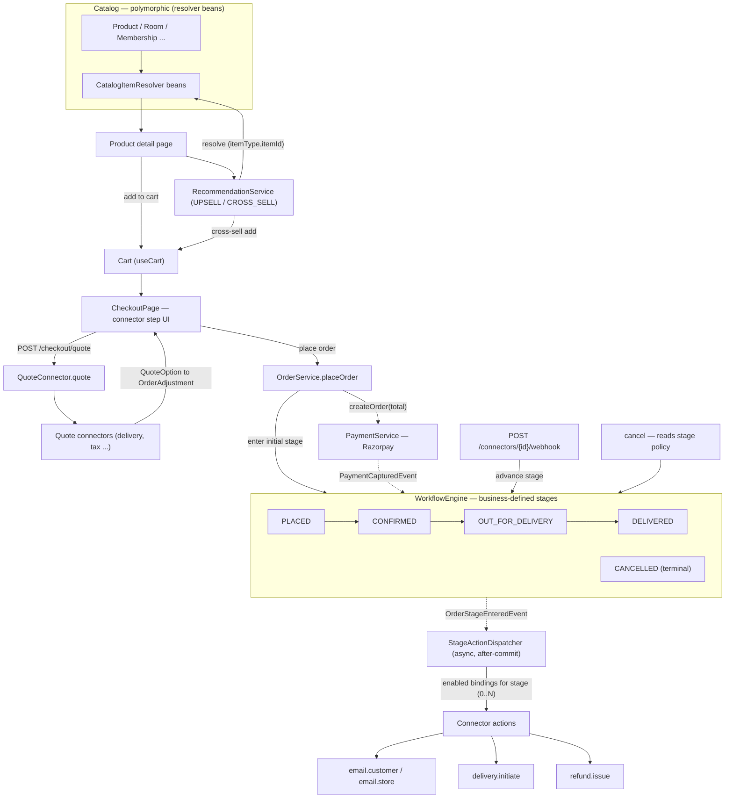
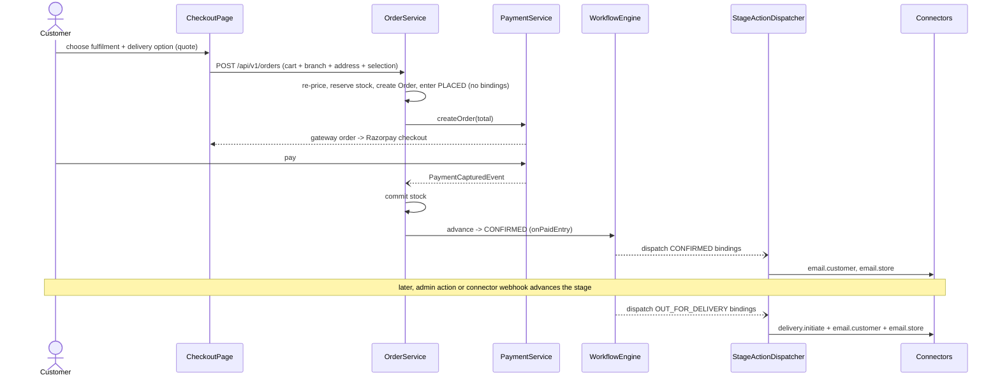
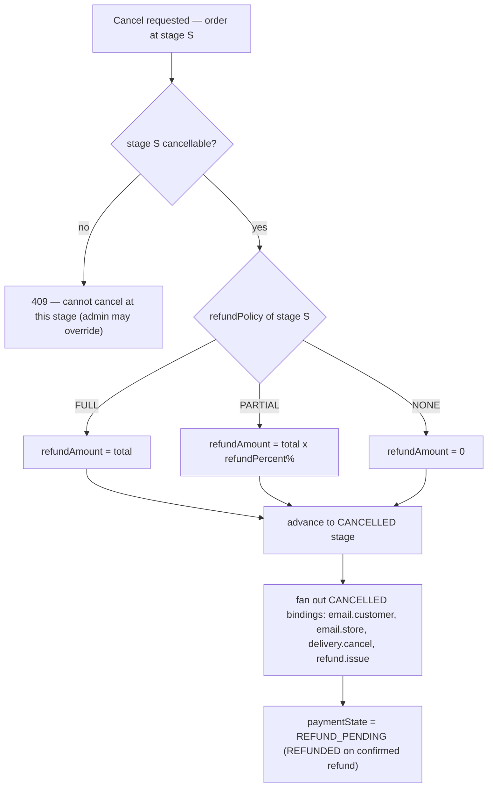

# Cross-Sell / Upsell Engines + Generalized Catalog — Implementation Plan

**Target repo:** `webapp-foundation` · **Stack:** Spring Boot 3 (Java 17) backend · React 19 + Vite + TS frontend
**Scope:** A **generalized sellable/catalog model** (usable by any business type), a batteries-included
**default `Product`**, the **cross-sell/upsell recommendation engines**, and **full admin configurability**
for both.

Built in a **foundation-compliant** way — grounded in the real foundation conventions
(`UserAdminService.bulkImport`, `AdminSupportController`, `supportHooks`, `AdminUsersPage`) and the two
`FOUNDATION_CONTRACT.md` cards.

---

## 0. Design decisions (locked)

### Generalize the *contract*, not the *storage*
The foundation already has a generic "sellable" model — it's **`CartItem`** (`{ id, name, unitPrice,
imageUrl, variantKey?, metadata? }`). The cart doesn't care whether an item is a dish, a room-night, a gym
membership, or a widget. We generalize on that same seam:

- A universal **`CatalogItemDto` / `Sellable` contract** is the exchange shape for cart, recommendations, and
  (later) payments.
- A batteries-included default **`Product`** entity ships so simple commerce businesses work out of the box.
- Richer businesses keep their own strongly-typed entity (`Room`, `Membership`, `Dish`) and map it to the
  same contract via a **`CatalogItemResolver`** bean. No universal table, no EAV/JSON-blob.

### Recommendations are polymorphic
Recommendation rows reference items by **`(itemType, itemId)`**, resolved to `CatalogItemDto` through the
matching resolver. The engine is business-agnostic; a new sellable type = one new resolver bean, **zero**
engine changes.

### Fenced vs. domain (promoted to fenced surface)
Built on the fenced spine (auth, cart, payments, media, audit, bulk-upload, AdminDataGrid). The **reusable
framework** (catalog contract + order/workflow/connector/inventory) is **promoted to fenced foundation
surface** — documented in `CLAUDE.md`, both `FOUNDATION_CONTRACT.md` cards, and `foundation.manifest.json` in
the **same commit** (Section 10, decision 5). The concrete default `Product` / `CatalogRecommendation` entities
ship as batteries-included defaults a project may extend.

### Out of scope
`POST_PURCHASE` — the Razorpay spine has no card tokenization / off-session charge, so the post-purchase
instant-charge engine can't be built as originally specified. The enum stays extensible; only `UPSELL` and
`CROSS_SELL` are implemented.

---

## 1. Backend — Catalog contract + default `Product`

Package `com.webappfoundation` (this repo), mirroring `UserAdminService` / `AdminSupportController` style.

### The universal contract
- `dto/CatalogItemDto.java` — the `Sellable` exchange shape:
  `String itemType; Long itemId; String name; String description; BigDecimal price; String priceUnit; String imageUrl; List<String> images; String slug; String detailPath; String category; boolean active; boolean cartable; String workflowCode; Map<String,Object> attributes;`
  - `workflowCode` = the order lifecycle (incl. its per-stage cancellation/refund policy) this item follows;
    the resolver supplies it (default = the default workflow). See Section 8.
  - `itemType` = business-defined key (`"PRODUCT"`, `"ROOM"`, `"MEMBERSHIP"`, …).
  - `itemId` = id within that type's own table.
  - `priceUnit` optional (e.g. `"per night"`, `"per session"`).
  - `detailPath` = the front-end route to the item's detail page (resolver supplies it, e.g.
    `/products/<slug>`), so the widget can link to any sellable type uniformly.
  - `cartable` = can this item be added to the cart with one click, or does it need configuration first
    (e.g. a hotel room needs dates)? Drives whether cross-sell shows "Add" vs "View details". Default `Product`
    is `cartable=true`.
  - `attributes` = small free-form long-tail only — **not** the primary model.
- `catalog/CatalogItemResolver.java` — per-business adapter interface:
  ```java
  interface CatalogItemResolver {
    String itemType();                                    // the type key this resolver handles
    List<CatalogItemDto> resolve(Collection<Long> ids);   // batch id -> dto (active items only)
  }
  ```
- `catalog/CatalogService.java` — collects all `CatalogItemResolver` beans into a `Map<String, resolver>`
  (injected `List<CatalogItemResolver>`), exposes `List<CatalogItemDto> resolve(String itemType, Collection<Long> ids)`
  and a batch `resolveMixed(...)` that groups ids by type and fans out to resolvers. Unknown type → skipped
  (logged), never throws.

### The default `Product` sellable
- `model/Product.java` — `Long id; String name; String slug; String description; BigDecimal price; BranchScope branchScope; Set<Long> availableBranchIds; boolean stockTracked; boolean stockPerBranch; Integer stock; Integer reserved; List<ProductVariant> variants; String imageUrl; List<String> images; String category; boolean active; String workflowCode; Instant createdAt; Instant updatedAt;`
  - `workflowCode` = which order lifecycle + cancellation/refund policy this product follows (admin-selectable;
    default = the default workflow). Different product kinds can follow different workflows.
  - **Branch availability (set when adding the product).** `branchScope` = `GLOBAL` (**default** — offered at
    every branch) or `SELECTED` (offered only at `availableBranchIds`, a `product_branches` join). Filters the
    public catalog + recommendations by the selected branch and is validated at checkout.
  - **Stock is opt-in per product.** `stockTracked` (default **false** = unlimited, e.g. food). When `true`,
    `stock`/`reserved` are a single **shared** pool and **available = stock − reserved**; set
    `stockPerBranch=true` to instead count stock **per branch** via `BranchStock`. Unlimited products skip all
    reservation logic entirely.
  - `variants` = optional product options such as **size** (`ProductVariant`). When present, stock (when
    tracked) is counted **per variant** (× branch when `stockPerBranch`), each variant may override `price`, and
    the product is **`cartable=false`** — the buyer must pick a variant on the detail page (no blind one-click Add).
- `model/BranchScope.java` — `enum { GLOBAL, SELECTED }`.
- `model/ProductVariant.java` (child entity) — `Long id; String label; String sku; BigDecimal price; boolean stockTracked; Integer stock; Integer reserved;`
  — `label` = the option, e.g. "S"/"M"/"L" or "500ml"; `price` null → inherit the product price; the stock
  fields hold the shared pool (per-branch counts live in `BranchStock`).
- `model/BranchStock.java` (child, used only when `stockPerBranch=true`) — `Long id; Long productId; Long variantId; Long branchId; Integer stock; Integer reserved;` — unique `(productId, variantId, branchId)`.
  - `images` uses the foundation multi-image pattern:
    `@ElementCollection @CollectionTable(name="product_images", joinColumns=@JoinColumn(name="product_id")) @OrderColumn(name="image_order") @Column(name="image_url")`.
    `imageUrl` is the thumbnail/primary. No byte storage, no upload endpoint — media-library URLs only.
- `repository/ProductRepository.java` — `findByActiveTrue()`, `findBySlug(String)`,
  `findByActiveTrueAndCategory(String)`, name `containsIgnoreCase` search, `findByIdIn(Collection<Long>)`.
- `dto/ProductDto.java` — the admin/detail shape for the Product entity (incl. `stockTracked`, a computed
  `available`, and the `variants`, each with its own computed `available`).
- `catalog/ProductCatalogResolver.java` — `@Component` implementing `CatalogItemResolver`; `itemType()` =
  `"PRODUCT"`; maps `Product` → `CatalogItemDto` (`detailPath = "/products/" + slug`;
  `cartable = variants.isEmpty() && inStock`). **This is the one shipped resolver** — a new business adds its
  own alongside it.
- `service/ProductService.java`
  - Public reads: `List<ProductDto> listActive(String category, String q, Long branchId)` (when `branchId` is
    given, returns only products offered at that branch — `GLOBAL` or `branchId ∈ availableBranchIds`),
    `getById(Long)`, `getBySlug(String)` → `ResourceNotFoundException` on miss.
  - Admin writes: `create(...)`, `update(Long, ...)`, `delete(Long)`.
  - `BulkUploadResult bulkImport(MultipartFile)` — copies `UserAdminService.bulkImport` exactly
    (`SpreadsheetParser.parse`, `rowNum` from 2, `result.addError(...)`, skip dup slug/name). Columns:
    `name, price, category, stockTracked, stock, workflowCode, branchSlugs` (all but `name`/`price` optional).
    `stockTracked` parses truthy `true/1/yes` (default `false` → `stock` ignored / unlimited); when `true`,
    `stock` must be a non-negative integer (else a per-row error). `branchSlugs` = comma-separated branch slugs
    (**empty → `GLOBAL`**; unknown slug → per-row error). **Variants and per-branch stock are not created via
    bulk in v1** (admin form only), so a bulk row imports a simple, variant-less product with a shared stock pool.
  - Injects `AuditService`, `record(...)`s on create/update/delete (no secrets/PII).

### Inventory & reservation (opt-in, per-type provider)
Overselling is prevented by a small **inventory SPI** mirroring `CatalogItemResolver`, so each sellable type
owns its own availability (products count units; a future room provider would check dates). Unlimited items are
a no-op, so food-style catalogs pay nothing for it.
```java
interface InventoryProvider {
  String itemType();
  boolean availableAt(Long itemId, Long branchId);                        // is the item offered at this branch?
  void reserve(Long itemId, String variantKey, Long branchId, int qty);   // atomic; 409 on shortfall
  void commit(Long itemId, String variantKey, Long branchId, int qty);    // reservation -> sold (on payment capture)
  void release(Long itemId, String variantKey, Long branchId, int qty);   // give back held/sold units (cancel / expiry / return)
}
```
- `inventory/InventoryService.java` — collects `List<InventoryProvider>` keyed by `itemType` (like
  `CatalogService`); `reserveAll / commitAll / releaseAll(List<OrderItem>, Long branchId)` fan each line to its
  provider, and `availableAll(items, branchId)` gates placement.
- `inventory/ProductInventoryProvider.java` — the shipped provider (`"PRODUCT"`). `availableAt` is true when the
  product is `GLOBAL` or `branchId ∈ availableBranchIds`. For `stockTracked=false` every stock op is a **no-op**
  (unlimited). For tracked stock it reserves with a **single atomic conditional update**
  — `UPDATE ... SET reserved = reserved + :qty WHERE (stock - reserved) >= :qty` (check rows affected) — on the
  **shared** row (product, or variant row when variants exist) by default, or on the **`BranchStock` row for
  `branchId`** when `stockPerBranch=true`; so there is **no oversell under concurrency** and no pessimistic
  lock. A shortfall is signalled with `ResponseStatusException(HttpStatus.CONFLICT, ...)` (auto-mapped to 409;
  **no change to the fenced `GlobalExceptionHandler`**).
- **Reservation TTL / payment reconciliation** — the payment spine emits only `PaymentCapturedEvent` (no
  failure event), so a failed or abandoned **online** payment is reconciled by a `@Scheduled` sweep: it releases
  reservations for orders still `AWAITING_PAYMENT` past `inventory.reservation-ttl` (e.g. 15m), sets
  `paymentState=FAILED`, and advances them to the terminal `CANCELLED` stage (reason = payment expired). A client
  may also cancel its own pending order immediately. (Does **not** apply to self-pickup pay-at-counter orders,
  which are intentionally unpaid until collection.)

### Controllers
- `controller/ProductController.java` → `/api/v1/products` (**public**): `GET` list (`category`, `q`,
  `branchId` — returns only items offered at that branch; omit for the global catalog), `GET /{id}`,
  `GET /slug/{slug}`. No `@CrossOrigin`.
- `controller/admin/AdminProductController.java` → `/api/v1/admin/products` (ADMIN, auto-gated by
  `SecurityConfig /api/v1/admin/**`): `GET` (all incl. inactive), `POST`, `PUT /{id}`, `DELETE /{id}`,
  `POST /bulk-upload` (multipart `file` → `BulkUploadResult`).

### Security note to verify
Confirm `SecurityConfig` permits unauthenticated `GET /api/v1/products/**` and
`GET /api/v1/recommendations/**` (like `/api/v1/gallery`). One line each if not already covered.

---

## 2. Backend — Recommendation engine (polymorphic)

- `model/CatalogRecommendation.java` —
  `Long id; String sourceItemType; Long sourceItemId; String targetItemType; Long targetItemId; @Enumerated(STRING) RecommendationType relationType; Double score; boolean active; Instant createdAt; Instant updatedAt;`
  — unique `(sourceItemType, sourceItemId, targetItemType, targetItemId, relationType)`.
- `model/RecommendationType.java` — `enum { UPSELL, CROSS_SELL }` (POST_PURCHASE deferred).
- `repository/CatalogRecommendationRepository.java` —
  `findBySourceItemTypeAndSourceItemIdAndRelationTypeAndActiveTrueOrderByScoreDesc(String, Long, RecommendationType)`;
  plain `findAll` for admin.
- `dto/RecommendationDto.java` (admin view) —
  `Long id; String sourceItemType; Long sourceItemId; String sourceItemName; String targetItemType; Long targetItemId; String targetItemName; RecommendationType relationType; Double score; boolean active;`
  (names resolved via `CatalogService` so the admin grid is readable).
- `service/RecommendationService.java`
  - Public: `List<CatalogItemDto> getRecommendations(String itemType, Long itemId, RecommendationType type, Long branchId)`
    — fetch rows, group `targetItemId`s by `targetItemType`, fan out to `CatalogService.resolve(...)`, preserve
    score order, drop items a resolver omits (inactive/deleted) **or not offered at `branchId`** — branch
    filtering uses the item type's `InventoryProvider.availableAt(itemId, branchId)` (when `branchId` given).
  - Admin CRUD + `bulkImport(MultipartFile)` (columns
    `sourceItemType, sourceItemId, targetItemType, targetItemId, relationType, score, active`; validate a
    resolver exists for each type and that ids resolve; skip self-reference and dup tuple).
  - `AuditService.record(...)` on every write.
- `controller/RecommendationController.java` →
  `GET /api/v1/recommendations?itemType=&itemId=&type=&branchId=` (**public**, `branchId` optional) →
  `List<CatalogItemDto>`.
- `controller/admin/AdminRecommendationController.java` → `/api/v1/admin/recommendations` (ADMIN): list,
  create, update, delete, bulk-upload.

---

## 3. Frontend — Catalog + Products (public + admin)

Following `supportService`/`supportHooks`/`AdminUsersPage` patterns.

### Shared contract
- `types/catalog.ts` — `CatalogItemDto` (mirror backend, incl. `itemType`, `itemId`, `detailPath`,
  `priceUnit`, `attributes`).
- `types/product.ts` — `ProductDto`.
- `services/productService.ts` — `apiClient`: `list({category?,q?,branchId?})`, `get(id)`, `getBySlug(slug)`; admin
  `adminList()`, `create()`, `update(id)`, `remove(id)`, `bulkUpload(file)` (multipart `FormData`).
- `hooks/productHooks.ts` — `useProducts(filter)`, `useProduct(id)`, `useAdminProducts()`, create/update/delete
  mutations wrapping `withToast(...)` (failures auto-toast via interceptor — no manual `toast.error`).

### Public pages (auto-routed via the page plan; shadcn/native tables — **never ag-grid on public pages**)
- `/products` → `pages/ProductsPage.tsx` — card grid, category filter + search; quick **"Add to cart"** via
  `useCart().addItem({ id, name, unitPrice: price, imageUrl })` for simple in-stock products, while products
  with variants or no availability show **"View" / "Out of stock"** instead.
- `/products/:slug` → `pages/ProductDetailPage.tsx` — gallery (`images`), description, price, a
  **size/variant selector** when the product has variants (updates price + availability), an **Add to cart**
  that passes `variantKey` and is **disabled when out of stock** (`available <= 0` for tracked stock),
  **and the UPSELL widget** ("Upgrade Options") beneath the description.

### Admin page
- `/admin/products` → `pages/admin/AdminProductsPage.tsx` — `AdminDataGrid<ProductDto>` + **compulsory**
  `BulkUploadDialog` + create/edit `Dialog`. Image fields use the fenced `ImagePicker` (thumbnail) and
  `MultiImagePicker` (gallery) — never a hand-rolled file input. The create/edit dialog includes a **Workflow**
  selector (default = default workflow), a **Branch availability** control (default **All branches**, or pick
  specific branches), a **Track stock** toggle (off = unlimited; on reveals a stock field), a **Stock per
  branch** toggle (when on + tracked, stock is entered per selected branch), and a **variants/sizes editor**
  (add options with a label, optional price override, and per-variant — × branch when stock-per-branch — stock).
  - `BulkUploadDialog` props match the backend keys:
    `columns={['name','price','category','stockTracked','stock','workflowCode','branchSlugs']}`,
    `sampleRow={['Widget','199','Gadgets','true','10','default','']}` (empty `branchSlugs` = all branches).
    (Variant-less, shared-stock products only — variants, per-branch stock, and specific branch availability are
    set via the create/edit dialog.)

---

## 4. Frontend — Recommendation widget & placement

- `types/recommendation.ts`, `services/recommendationService.ts`, `hooks/recommendationHooks.ts` —
  `useRecommendations(itemType, itemId, type, branchId?)` (react-query; `enabled: !!itemId`; passes the selected
  branch so only items offered there show), plus admin CRUD hooks.
- `components/recommendations/RecommendationWidget.tsx` — the spec's component, rewritten: **TypeScript,
  Tailwind (no inline styles), `apiClient` (no hardcoded host), react-query (no manual `useEffect`+`fetch`)**.
  Operates on `CatalogItemDto[]`, so it works for any sellable type:
  - `UPSELL` → "View details" → navigate to `item.detailPath`.
  - `CROSS_SELL` → "Frequently bought together". For a **`cartable`** item, one-click **Add** →
    `useCart().addItem({ id: \`${itemType}:${itemId}\`, name, unitPrice: price, imageUrl, metadata: { itemType, itemId } })`
    (composite id avoids cross-type collisions); optional `toast.success('Added to cart')` (local state, not an
    API mutation). A **non-`cartable`** item (needs configuration, e.g. a room + dates) shows "View details"
    → `item.detailPath` instead of a blind Add.

### Placement — fenced-page constraint
- `UPSELL` → `ProductDetailPage` (we own it). ✅
- `CROSS_SELL` → **`CartPage.tsx` is fenced (cannot edit).** So cross-sell renders on: (a) `ProductDetailPage`
  as "Frequently bought together", and (b) if wanted in the checkout flow, we replace the *replaceable*
  `CheckoutPage.tsx` with a richer version that still drives `useCart()`/`useCheckout(steps)` and embeds the
  widget. We **cannot** inject it into the slide-out cart drawer / `/cart` without unfencing that page.

### Admin configurability of recommendations
- `/admin/recommendations` → `pages/admin/AdminRecommendationsPage.tsx` — `AdminDataGrid<RecommendationDto>`
  (columns: source item, target item, type, score, active) + create/edit dialog with **item pickers**. For the
  default catalog these are product searches fed by `useAdminProducts()`; the `itemType` field is a select
  (defaults to `"PRODUCT"`, extensible as businesses add resolvers). Plus type select (`UPSELL`/`CROSS_SELL`),
  score input, active toggle, and `BulkUploadDialog`.

---

## 5. Shell / navigation wiring

- Add `{ label: 'Products', href: '/products' }` to the public nav in `src/config/siteConfig.ts`; the header
  also shows the **branch picker** (selected outlet + change) and, for logged-in users, links to `/orders`.
- Admin nav gets **Products**, **Recommendations**, **Orders**, **Branches**, **Workflow**, **Connectors**, and
  **Feedback** entries.
- All new pages route **via the page plan**, not by editing `AppRoutes.tsx`/`App.tsx` (fenced, auto-derived).
  Admin pages auto-wrap in `AdminLayout`, public in `SiteLayout`.

---

## 6. Build order & verification

1. Backend catalog contract (`CatalogItemDto`, `CatalogItemResolver`, `CatalogService`).
2. Backend default `Product` + variants + inventory (entity + `ProductVariant` → repo → DTO →
   `ProductCatalogResolver` → `InventoryProvider`/`InventoryService`/`ProductInventoryProvider` +
   reservation-TTL sweep → service+bulk+audit → public + admin controllers); verify `SecurityConfig` public GET.
3. Backend Recommendations (polymorphic entity → repo → service resolving via `CatalogService` → public +
   admin controllers).
4. Frontend catalog/product types, service/hooks → public pages → admin page.
5. Recommendation service/hooks → `RecommendationWidget` → wire UPSELL into detail page, CROSS_SELL into
   detail page (+ optional CheckoutPage replacement).
6. Admin recommendations page.
7. **Workflow + connector core (Section 8 backend) — build this BEFORE the order service that depends on it:**
   `Workflow`/`WorkflowStage`(+cancellation policy, workflow-scoped keys)/`WorkflowBinding` + repos + invariants
   + connector SPI + `ConnectorRegistry` + `WorkflowEngine` (idempotent `advance`) + `StageActionDispatcher`
   (`WorkflowExecution` dedupe) + `EmailConnector`/`DemoDeliveryConnector`/`DemoRefundConnector` + inbound
   webhook controller.
8. Order spine (Section 7): `Order`/`OrderItem`/`OrderAdjustment` + `OrderService` (place with prepaid **and**
   online + self-pickup pay-at-counter/₹0 paths, re-price via `CatalogService`, mixed-workflow reject, quote,
   cancel, mark-paid) + `PaymentCapturedEvent`
   `@TransactionalEventListener` + customer/admin controllers + admin orders page + admin workflow builder +
   admin connectors page.
9. Frontend order + checkout: `types/order.ts`, `orderService`/`orderHooks`, `/orders` + `/orders/:id` (cancel
   button with refund preview), `connectors/registry.ts`, and the **replaced `CheckoutPage` with the real
   Razorpay client flow** (load the Razorpay SDK, open the modal, call `verifyPayment`) + connector step UI +
   mixed-workflow-cart guard. (This client payment flow does not exist in the foundation today — net-new.)
10. Verify end-to-end: `mvn` compile/test backend; `npm run build` (tsc) frontend; manual pass — create a
    product, mark two as UPSELL/CROSS_SELL of a third, confirm widgets render and a `cartable` "Add" updates the
    cart badge; place a prepaid order and confirm **no** emails fire until payment, then payment capture enters
    the `onPaidEntry` stage and fires customer + store emails; a duplicate webhook does **not** double-fire
    (dedupe); place a self-pickup pay-at-counter order and confirm it advances to preparation while unpaid, then
    admin `mark-paid` settles it (and a ₹0 order skips payment); admin-advance to `OUT_FOR_DELIVERY`
    runs all three bound actions (initiate delivery + both emails); cancel early → FULL refund `REFUND_PENDING`,
    cancel at a `cancellable=false` stage → rejected (and the `food` workflow yields PARTIAL where configured);
    a tracked-stock product rejects over-ordering (409) and decrements on payment / restocks on cancel while an
    unlimited (food) product never blocks, a variant product requires a size selection, and an abandoned unpaid
    order releases its reservation after the TTL; a `SELECTED`-branch product is hidden and its checkout blocked
    (409) when a different branch is selected while a `GLOBAL` product shows everywhere, and a `stockPerBranch`
    product counts stock independently per branch; place an order at a branch, pick a saved address, and leave
    post-checkout feedback; confirm bulk-upload, `WorkflowExecution` rows, and audit rows at `/admin/logs`.
11. Branches + address book (Section 11): `Branch`/`BranchService` (+ `nearest`) + public/admin controllers +
    `/branches` + `/admin/branches`; then **wire product→branch availability** (`branchScope`/`availableBranchIds`)
    and optional **per-branch stock** (`BranchStock`) into the catalog listing + branch-aware `InventoryProvider`
    (the `Product` fields from step 2 reference `Branch`, so this completes here); `UserAddress` book
    (`AddressService` + customer endpoints) + account address book + checkout address picker; `Order.branchId` +
    header branch picker with geolocation auto-select.
12. Post-checkout feedback (Section 12): `OrderFeedback` + `POST /api/v1/orders/{id}/feedback` + minimal
    confirmation-screen form + read-only `/admin/feedback`.
13. **Foundation documentation & fencing (SAME commit as the spine code)** — add the new fenced surface to both
    `FOUNDATION_CONTRACT.md` cards, a rule to `CLAUDE.md`, and feature entries to `foundation.manifest.json`
    (details in Section 10, incl. branches/address/feedback). Per the `CLAUDE.md` same-commit rule, a
    fenced-surface change must not merge with a stale card/manifest.

### How a new business type / connector plugs in (the generalization payoff)
- **New sellable type** (`Room`, `Membership`, …): keep the typed entity + add one
  `@Component implements CatalogItemResolver` (`itemType()` + `resolve(ids)` → `CatalogItemDto` with a
  `detailPath`). Cart, recommendation engine, and admin recommendations UI work against it — no engine edits.
- **New connector** (a delivery/tax/loyalty service): add one `@Component` implementing the relevant SPI
  interface(s) (`ActionConnector` + `QuoteConnector` + `WebhookConnector`) and declare its `actions()`. It
  immediately appears in the admin connectors list and workflow builder; bind its actions to any stage. For a
  checkout-step UI, add one `registerCheckoutConnector({...})` on the frontend — no engine edits.
- **New/changed workflow or cancellation policy**: reshape stages, stage→action bindings, and each stage's
  `cancellable`/`refundPolicy`/`refundPercent` entirely from `/admin/workflow`; point a product at a workflow
  from its admin form — no code change at all.

### Rule-compliance checklist (baked in)
- No second `<Toaster/>`; `withToast` on mutations, no manual `toast.error`.
- ag-grid admin-only; shadcn/native on public pages.
- `BulkUploadDialog` + `/bulk-upload` on both admin entities.
- `AuditService` on all writes.
- Images via media library only (no byte storage, no new upload endpoint).
- Identity server-derived (no `userId` in payloads/paths).
- No edits to fenced files (`CartPage`, `App.tsx`, `AppRoutes.tsx`, `LoginPage`, `SignupPage`, etc.).

---

## 7. Backend — Order spine (the connector anchor)

The foundation currently does **not persist an order** — the prebuilt `CheckoutPage` just clears the cart. A
thin generic order spine is required so connectors (delivery, tax, …) have something to attach to. Shipped
batteries-included, like the default `Product`.

- `model/Order.java` — `Long id; Integer userId; String orderNumber; String referenceId; Long branchId; String branchName; FulfillmentType fulfillmentType; PaymentMode paymentMode; String workflowCode; String currentStageCode; PaymentState paymentState; BigDecimal subtotal; BigDecimal total; BigDecimal refundAmount; String cancelReason; String currency; Address shippingAddress (embeddable, null for self-pickup); List<OrderItem> items; List<OrderAdjustment> adjustments; Instant createdAt; Instant updatedAt;`
  - `branchId` / `branchName` = the outlet fulfilling the order (see Section 11); set at `placeOrder` from the
    client-selected branch. For **self-pickup** this is the pickup location and `shippingAddress` is null; for
    **delivery** `shippingAddress` is a snapshot copied from the chosen saved address (Section 11).
  - `orderNumber` = a short human-friendly id (e.g. `ORD-2026-000123`) shown to users; `referenceId`
    (`order_<id>`) stays the opaque payment reference.
  - `fulfillmentType` = `DELIVERY` | `SELF_PICKUP`. `paymentMode` = `ONLINE` (default) | `PAY_AT_COUNTER`
    (**only** valid with `SELF_PICKUP` — order placed unpaid, settled at the counter on collection).
  - `workflowCode` = the order's lifecycle, set at `placeOrder` from its items (default workflow if unset).
  - `currentStageCode` = the business-defined workflow stage the order is in (see Section 8). **Not** a fixed
    enum — stages are configured per business.
  - `refundAmount` / `cancelReason` = populated on cancellation per the current stage's refund policy.
  - `paymentState` = minimal system enum `{ AWAITING_PAYMENT, PAID, FAILED, REFUND_PENDING, REFUNDED }` for
    payment reconciliation only (kept separate from the business workflow). `REFUND_PENDING` = a refund was
    computed and a `refund.*` action dispatched; `REFUNDED` is set **only** when a refund connector confirms
    the money actually moved.
  - `referenceId` = the opaque payment reference (e.g. `order_<id>`) — links to the `Payment` spine with no FK
    (foundation rule: payments link by `referenceId` string).
  - `userId` = `Integer` (`@CurrentUser`), never sent from the client.
- `model/OrderItem.java` — `Long id; String itemType; Long itemId; String variantKey; String variantLabel; String name; BigDecimal unitPrice; int quantity; String imageUrl;`
  — uses the **same `(itemType, itemId)`** polymorphic catalog reference as recommendations; `variantKey`
  (+ human `variantLabel`, e.g. "M") snapshots the chosen size/option and is the key used for inventory reservation.
- `model/OrderAdjustment.java` (embeddable/element collection) — `String code; String label; BigDecimal amount; String connectorId;`
  — reuses the cart's `adjustments` concept; connectors contribute these (shipping fee, tax, discount).
- `model/FulfillmentType.java` — `enum { DELIVERY, SELF_PICKUP }`; `model/PaymentMode.java` — `enum { ONLINE, PAY_AT_COUNTER }`.
- `dto/PlaceOrderRequest.java` — `List<CartLineInput> items; Long branchId; FulfillmentType fulfillmentType; PaymentMode paymentMode; Long addressId; Map<String,String> connectorSelections;`
  — `addressId` references a saved `UserAddress` (**required for `DELIVERY`**, omitted for `SELF_PICKUP`); the
  server snapshots it into `Order.shippingAddress`. `CartLineInput { String itemType; Long itemId; String variantKey; int quantity; }` carries **no prices** (re-priced server-side).
- `repository/OrderRepository.java` — `findByUserIdOrderByCreatedAtDesc(Integer)`, `findByReferenceId(String)`, admin `findAllByOrderByCreatedAtDesc()`.
- `service/OrderService.java`
  - `OrderDto placeOrder(Integer userId, PlaceOrderRequest req)` — snapshots cart items, **re-prices
    server-side via `CatalogService.resolve((itemType,itemId))`** (never trust client prices), re-runs the quote
    connectors to re-validate the client-selected adjustments, computes `total`, resolves the order's
    `workflowCode` from its items (rejecting mixed-workflow carts, see Section 8), **validates every line is
    available at the chosen `branchId` and reserves inventory via `InventoryService.availableAll(...)` +
    `reserveAll(items, branchId)`** (unavailable item or shortfall → `409`, the whole order aborted before any
    payment), and persists the order at the workflow's **initial stage** with `paymentState=AWAITING_PAYMENT`.
    - **Online payment (default):** the initial stage carries **no bindings** — notification/fulfillment actions
      do **not** fire for an unpaid order (no premature "order placed" emails). `placeOrder` then calls
      `PaymentService.createOrder(total, currency, "order_"+id)` and returns payment-order info for checkout;
      the first notifying stage is the `onPaidEntry` one, entered on payment capture.
    - **Self-pickup "pay at counter" (`SELF_PICKUP` + `PAY_AT_COUNTER`) & ₹0 orders:** `placeOrder` skips
      `createOrder`, **commits** the reservation, and immediately
      `WorkflowEngine.advance(order, <onPaidEntry stage>, trigger=SYSTEM)` so the outlet starts preparing.
      `paymentState` stays `AWAITING_PAYMENT` until a ₹0 order (set `PAID`) or staff settle it at pickup via
      **`markPaid`** (admin). COD for delivery is **not** supported in v1 (deferred — see Resolved decisions).
    - **Branch + address + fulfilment:** sets `branchId`/`branchName` from the client-selected outlet (validated
      active) and `fulfillmentType`. For `DELIVERY` the chosen saved `UserAddress` is **snapshotted into
      `Order.shippingAddress`** (required; Section 11) and delivery `QuoteConnector`s apply; for `SELF_PICKUP` no
      address is required (the branch is the pickup point) and delivery quotes are skipped. (Line availability +
      reservation run against this `branchId`, above.)
  - `@TransactionalEventListener(phase = AFTER_COMMIT) PaymentCapturedEvent` — matched by `referenceId` (capture
    arrives in the webhook/verify transaction; `PaymentService` already de-dupes the publish) → set
    `paymentState=PAID`, `InventoryService.commitAll(order.items)` (reservation → sold), and
    `WorkflowEngine.advance(order, <onPaidEntry stage>, trigger=PAYMENT)` (idempotent — a duplicate capture is a no-op).
  - `List<OrderDto> myOrders(Integer userId)`, `OrderDto get(Integer userId, Long id)` (ownership-checked),
    admin `all()`, `advanceStage(Long, String stageCode)` (manual admin transition),
    `markPaid(Long id)` (admin — settles a `PAY_AT_COUNTER` order: `paymentState=PAID`, audited),
    `bulkImport(MultipartFile)` (compulsory).
  - `OrderDto cancel(Long orderId, String reason, boolean adminOverride)` — reads the current stage's
    cancellation policy (Section 8, scoped by the order's `workflowCode`); rejects with 409 if `!cancellable`
    (unless `adminOverride`); computes `refundAmount` from the policy; advances to the terminal `CANCELLED`
    stage (fans out its bound actions, incl. a `refund.*` action when `refundAmount > 0`); sets
    `paymentState=REFUND_PENDING` when a refund is due (→ `REFUNDED` only once a refund connector confirms); and
    restocks via `InventoryService.releaseAll(order.items)` (held units for an unpaid order, sold units for a paid return).
  - `AuditService.record(...)` on place / stage change / cancel (incl. the computed refund amount, never card/PII).
- Controllers:
  - `controller/OrderController.java` (auth, `@CurrentUser`): `POST /api/v1/orders` (place),
    `POST /api/v1/checkout/quote` (run quote connectors for current cart + address → options),
    `GET /api/v1/orders`, `GET /api/v1/orders/{id}`, `POST /api/v1/orders/{id}/cancel` (body `{ reason }`;
    ownership + stage-policy checked).
  - `controller/admin/AdminOrderController.java` (ADMIN): `GET`, `PUT /{id}/stage` (advance to a stage, re-fires
    its actions), `POST /{id}/cancel` (admin override of the policy), `POST /{id}/mark-paid` (settle a
    pay-at-counter pickup order), `POST /bulk-upload`.

---

## 8. Backend + Frontend — Configurable workflow + connector framework (the "space")

Attaching external services (delivery, tax, insurance, loyalty, notifications, …) to the order workflow is
**data-driven**: a business defines its own ordered **stages**, and each stage has **0..N connector actions**
bound to it that run when an order enters that stage. "Out for delivery → initiate delivery + email customer +
email store" is just three bindings on one stage. Different businesses = different stages + different bindings,
all editable from the admin dashboard — **no engine edits**. Built on the same Spring bean-registry +
async-event patterns the foundation already uses.

### Workflow model (DB-configured, admin-editable)
```java
class Workflow        { Long id; String code; String label; boolean isDefault; }  // a named lifecycle; products pick one
class WorkflowStage   { Long id; String workflowCode; String code; String label; int ordinal;
                        boolean initial;          // order enters here on placeOrder
                        boolean onPaidEntry;       // entered on payment capture (or immediately for pickup pay-at-counter / ₹0)
                        boolean terminal;          // completed/cancelled
                        // --- per-stage cancellation policy ---
                        boolean cancellable;       // may the order be cancelled while in this stage?
                        RefundPolicy refundPolicy; // FULL | PARTIAL | NONE if cancelled here
                        Integer refundPercent; }   // for PARTIAL (0-100); ignored for FULL/NONE
                        // NOTE: (workflowCode, code) is unique; a bare `code` like OUT_FOR_DELIVERY MAY repeat across workflows.
enum RefundPolicy { FULL, PARTIAL, NONE }
// A binding ties one connector-action to ONE stage — by the stage's unique id (NOT its code, which repeats
// across workflows). Many bindings per stage = fan-out; zero = nothing runs.
class WorkflowBinding { Long id; Long stageId; String connectorId; String actionCode;
                        int ordinal; boolean enabled; Map<String,String> params; }
```
- Seeded default workflow `default` (simple commerce / e-commerce): `PLACED(initial) → CONFIRMED(onPaidEntry) →
  OUT_FOR_DELIVERY → DELIVERED(terminal)` + a terminal `CANCELLED` stage; **every** stage
  `cancellable=true, FULL` (e-commerce can cancel/return any time for a full refund). Default bindings e.g.
  `PLACED → email.customer, email.store`. A second seeded `food` workflow shows the contrast: `PLACED`/
  `CONFIRMED` FULL, `PREPARING` PARTIAL(50), `OUT_FOR_DELIVERY` `cancellable=false`. Businesses reshape
  workflows/stages/bindings in admin.
- `repository/WorkflowRepository`, `repository/WorkflowStageRepository`, `repository/WorkflowBindingRepository`
  — stages: `findByWorkflowCodeOrderByOrdinal(String)`, `findByWorkflowCodeAndCode(String, String)`; bindings
  keyed by stage id: `findByStageIdAndEnabledTrueOrderByOrdinal(Long)`. **Every stage/binding lookup is scoped
  by the order's `workflowCode` → stage id — never by a bare `code`** (two workflows can share a code).
- **Invariants** (enforced on seed + admin save): each workflow has **exactly one `initial`** stage and
  **at most one `onPaidEntry`** stage; `(workflowCode, code)` is unique; a `terminal` `CANCELLED` stage exists.

### Cancellation & refund — stage-aware, per product kind
- Cancellation eligibility and refund amount are **properties of the stage**, so they differ per business
  automatically (no code). E-commerce: every stage `cancellable, FULL`. Food delivery: `FULL` before
  preparation, `PARTIAL` while preparing, `cancellable=false`/`NONE` once out for delivery.
- **Each product kind selects its own workflow** via `Product.workflowCode` / `CatalogItemDto.workflowCode`;
  `Order.workflowCode` is set at `placeOrder` from the items. A store selling both goods and prepared food runs
  two workflows with different cancellation rules. **Mixed-workflow cart v1 rule: reject at checkout** (one
  order = one workflow) — silently falling back to `default` would wrongly give a strict item (food) the
  "full refund anytime" policy. Per-workflow order splitting is a later option.
- **Refund execution is a connector action.** `OrderService.cancel` computes the amount from the stage policy
  and the terminal `CANCELLED` stage carries the refund action in its bindings (e.g. `refund.razorpay`) —
  money movement stays in the same extensible model as every other stage action.
  ⚠️ **Gap:** the fenced `PaymentService` has `createOrder/verify/handleWebhook` but **no `refund(...)`**, so
  automated money-return isn't possible through the spine today. v1 ships a `DemoRefundConnector`
  (`id="refund.demo"`, action `refund.issue`) that records the refund intent + amount for the admin to settle
  in the Razorpay dashboard. Automated refunds need a payment-spine extension (`PaymentService.refund` +
  gateway support) — a **fenced change** (contract card + manifest per `CLAUDE.md`). Flagged follow-up.

### Connector SPI — `connector/` (action-oriented)
```java
enum ConnectorCategory { SHIPPING, TAX, DISCOUNT, PAYMENT, FULFILLMENT, NOTIFICATION, OTHER }

interface OrderConnector {                 // base — every connector
  String id();                             // stable unique, e.g. "shipping.delhivery", "email"
  String displayName();
  ConnectorCategory category();
  boolean enabled();                       // from ConnectorConfig (DB flag + env presence)
  Set<ConnectorAction> actions();          // the named actions it can be bound to, e.g. {delivery.initiate} or {email.customer, email.store}
}
class ConnectorAction { String code; String label; }   // declared so the admin UI can offer it as a binding target

interface ActionConnector extends OrderConnector {       // runs a bound action when an order enters a stage (async)
  ConnectorResult execute(String actionCode, OrderStageContext ctx);
}
interface QuoteConnector extends OrderConnector {        // checkout-time, synchronous — contributes priced options
  List<QuoteOption> quote(CheckoutContext ctx);
}
interface WebhookConnector extends OrderConnector {      // inbound callbacks — may advance the order's stage
  void handleWebhook(String payload, Map<String,String> headers);
}

class CheckoutContext   { Integer userId; List<OrderItemSnapshot> items; BigDecimal subtotal; Address shippingAddress; Map<String,String> selections; }
class QuoteOption       { String connectorId; String code; String label; BigDecimal amount; String detail; } // -> OrderAdjustment
class OrderStageContext { Long orderId; String referenceId; Integer userId; String stageCode; List<OrderItemSnapshot> items; Address shippingAddress; Map<String,String> params; }
class ConnectorResult   { boolean ok; String detail; }  // recorded per invocation for audit + retry
```
- `connector/ConnectorRegistry.java` — injects `List<OrderConnector>`; exposes `byId(String)`,
  `quoteConnectors()`, and `actionConnectors()`. Only `enabled()` connectors participate. Also surfaces every
  connector's declared `actions()` so the admin workflow builder can offer them.
- `connector/ConnectorConfig.java` — non-secret enable/settings from DB (admin-editable); secrets (API keys)
  from env/properties. **Secrets never enter audit events or logs** (foundation rule).

### Workflow engine (the fan-out)
- `workflow/WorkflowEngine.java` — `advance(Order, String toStageCode, TriggerType trigger)`
  (`TriggerType { SYSTEM, PAYMENT, WEBHOOK, ADMIN, RETRY }`): validates the transition, sets `currentStageCode`,
  persists, publishes `OrderStageEnteredEvent{ orderId, workflowCode, stageCode, trigger, dispatchId }`.
  **Idempotent for automatic triggers** (`SYSTEM`/`PAYMENT`/`WEBHOOK`): if the order is already at or past
  `toStageCode`, it's a no-op — so a redelivered payment/connector webhook can't double-advance. Only `ADMIN`
  can deliberately re-enter a stage.
- `workflow/StageActionDispatcher.java` — `@Async @TransactionalEventListener(phase = AFTER_COMMIT, fallbackExecution = true)`
  on `OrderStageEnteredEvent`: loads the stage's enabled `WorkflowBinding`s **by `stageId`** (ordered), and for
  each calls `connectorRegistry.byId(connectorId).execute(actionCode, ctx)`. **Dedupe:** a binding already
  recorded `SUCCESS` for this `(orderId, stageId, bindingId)` in `WorkflowExecution` is **skipped** unless the
  trigger is an explicit admin `RETRY` — so a duplicate event never re-sends an email, re-initiates delivery, or
  re-issues a refund. Each invocation is **isolated** (one failure never blocks the others), **audited**
  (`AuditService`, no secrets), and recorded as a `WorkflowExecution` row (PENDING/SUCCESS/FAILED + detail).
  Domain → connector direction, no bean cycle — mirrors the email listener.
- `event/OrderStageEnteredEvent` (+ `OrderPlacedEvent`, `OrderCancelledEvent`) — `{ Long orderId; String workflowCode; String stageCode; TriggerType trigger; }`.

### Built-in actions as connectors
The foundation email spine is exposed as `connector/builtin/EmailConnector` (`id="email"`, actions
`email.customer` / `email.store`) so "email customer" / "email store" are bindable like any connector action —
one uniform model. `connector/demo/DemoDeliveryConnector` (`id="delivery.demo"`) implements `QuoteConnector`
(Standard/Express flat rates), `ActionConnector` (`delivery.initiate`), and `WebhookConnector` (advances the
order to `OUT_FOR_DELIVERY`/`DELIVERED`) — the copy-me template that keeps the framework exercised in the build.

### Inbound webhooks
- `controller/ConnectorWebhookController.java` → `POST /api/v1/connectors/{connectorId}/webhook` (public,
  per-connector signature-verified like the payment webhook) → `ConnectorRegistry.byId(id).handleWebhook(...)`
  → typically `WorkflowEngine.advance(order, <stage>, trigger=WEBHOOK)` (idempotent — a redelivered webhook that
  targets a stage the order already passed is a no-op).

### Admin configurability — the workflow builder
- `/admin/workflow` → `pages/admin/AdminWorkflowPage.tsx` — manage multiple named **workflows**; within each,
  define/reorder/rename **stages**, set each stage's **cancellation policy** (`cancellable` +
  `refundPolicy` + `refundPercent`), and attach/detach/reorder **connector actions** (multi-select over the
  registry's declared actions; 0..N per stage, per-binding enable + params). This is the step/connector/
  cancellation wiring surface. Backend `GET/PUT /api/v1/admin/workflow` (workflows + stages + bindings).
- `/admin/connectors` → `pages/admin/AdminConnectorsPage.tsx` — list registered connectors (id, category,
  enabled, declared actions), toggle enable/disable, edit non-secret settings (secrets shown as "configured via
  env", never rendered). Backend `GET/PUT /api/v1/admin/connectors`.
- `/admin/orders` detail shows the stage timeline + each stage's `WorkflowExecution` rows with a **Retry** action
  for failed invocations.

### Frontend
- `types/order.ts`, `services/orderService.ts` (`placeOrder`, `quote`, `myOrders`, `get`; admin
  list/advance-stage/cancel/mark-paid), `hooks/orderHooks.ts`.
- Pages: `/orders` (customer order history, `RequireAuth`), `/orders/:id` (detail + stage timeline + a
  **Cancel order** button shown only when the current stage is `cancellable`, previewing the refund the policy
  grants), `/admin/orders` (`AdminDataGrid` + advance-stage + admin cancel/override + **mark-paid** for
  pay-at-counter pickups + bulk-upload).
- `connectors/registry.ts` — client mirror for **checkout-step UI** only: `registerCheckoutConnector({ id, category, StepComponent?, toSelection })`.
  The replaced **`CheckoutPage`** composes `useCheckout(steps)`: a **fulfilment selector** (delivery /
  self-pickup), then for delivery an **address picker** (saved `UserAddress`) + a delivery-option picker that
  calls `POST /api/v1/checkout/quote`, or for pickup a **branch confirm** + a **pay now / pay at counter**
  choice; it stores the selection, places the order, and runs the Razorpay flow for online payment (skipped for
  pay-at-counter / ₹0). `CartPage` stays fenced/untouched. (Post-placement stage actions are backend-only — the
  frontend just displays the resulting stage/timeline.)

---

## 9. Spine flow diagrams

> Each diagram is shown twice: a **plain-text (ASCII)** version that renders in any viewer, followed by a
> **Mermaid** version (GitHub, VS Code + Mermaid extension, Obsidian, or https://mermaid.live render it as a
> picture). Solid arrows = direct calls; dashed / `....` arrows = async Spring events.

### 9.1 End-to-end spine (components + flow)

```text
CATALOG (polymorphic; CatalogItemResolver beans)
    Product / Room / Membership ...
            |
            v
    CatalogItemResolver beans  <-----------------------------+
            |                                                |
            v                                 resolve (itemType,itemId)
    Product detail page  ----> RecommendationService (UPSELL / CROSS_SELL)
            |      \                               |
            |       \ cross-sell "Add"             | (resolved items)
            v        v                             v
         CART (useCart)  <---------------------------+
            |
            v
    CheckoutPage (connector step UI)
            |  POST /checkout/quote
            v
    QuoteConnector.quote  ---->  [ delivery / tax quote connectors ]
            |  QuoteOption -> OrderAdjustment
            v
    OrderService.placeOrder
            |----------------> PaymentService (Razorpay): createOrder(total)
            |                         |
            | enter initial stage     | customer pays
            v                         v
    WorkflowEngine  <....... PaymentCapturedEvent (async) .......+
       PLACED -> CONFIRMED -> OUT_FOR_DELIVERY -> DELIVERED
                                          CANCELLED (terminal)
            |
            |  OrderStageEnteredEvent (async, after commit)
            v
    StageActionDispatcher
            |  enabled bindings for the entered stage (0..N)
            v
    Connector actions:
        - email.customer / email.store
        - delivery.initiate
        - refund.issue

    Inbound webhook:  POST /connectors/{id}/webhook  --> advance stage --> WorkflowEngine
    Cancel:           cancel (reads stage policy)     --> advance stage --> WorkflowEngine
```



### 9.2 Happy path (place → pay → fulfil)

```text
 1. Customer picks fulfilment (delivery/pickup) + delivery option (quote) on CheckoutPage
 2. CheckoutPage --> OrderService:  POST /api/v1/orders  (cart + branch + address + selection)
 3. OrderService:  re-price, reserve stock, create Order, enter PLACED (initial — NO bindings, nothing fires)
 4. OrderService --> PaymentService:  createOrder(total)  --> Razorpay checkout
 5. Customer pays
 6. (async) PaymentCapturedEvent --> OrderService:  commit stock + advance to CONFIRMED (onPaidEntry)
 7. (async) dispatch CONFIRMED bindings --> email.customer + email.store   (first notification, post-payment)
 8. Later: admin action OR connector webhook --> advance to OUT_FOR_DELIVERY
 9. (async) dispatch OUT_FOR_DELIVERY bindings --> delivery.initiate + email.customer + email.store
 (Self-pickup pay-at-counter / ₹0: skip 4–6; enter CONFIRMED at placement, settle later via admin mark-paid.)
```



### 9.3 Cancellation (stage-aware refund)

```text
Cancel requested (order at stage S)
        |
        v
  [ stage S cancellable? ] --- no ---> 409: cannot cancel here (admin may override)
        | yes
        v
  [ refundPolicy of stage S ]
        FULL     -> refundAmount = total
        PARTIAL  -> refundAmount = total x refundPercent%
        NONE     -> refundAmount = 0
        |
        v
  advance order to CANCELLED stage
        |
        v
  fan out CANCELLED bindings:
     email.customer, email.store, delivery.cancel, refund.issue
        |
        v
  paymentState = REFUND_PENDING  (REFUNDED once the refund connector confirms)
```



---

## 10. Foundation documentation & fencing (action item)

The reusable spine (catalog contract + order/workflow/connector/inventory framework) is **promoted to fenced
foundation surface** so every generated project **binds to it and never reimplements it**. Do all four in the
**same commit** as the code (the `CLAUDE.md` same-commit rule — a fenced-surface change must never ship with a
stale card/manifest):

- **`CLAUDE.md`** — add a rule under *"Foundation rules generated code MUST follow"*:
  - **Orders/checkout/fulfillment run on the fenced order spine.** Inject `OrderService`; the order lifecycle is
    a DB-configured **workflow** of stages, each with 0..N **connector actions** — never hardcode lifecycle steps
    or write your own order/checkout persistence. Orders carry a `fulfillmentType` (delivery / self-pickup; pickup
    may be `PAY_AT_COUNTER`).
  - **Attach external services via connectors.** Delivery, tax, loyalty, refunds, notifications, … are
    **connector beans** bound to a stage at `/admin/workflow`; never call a third-party API inline from domain
    code.
  - **Sellables bind to the fenced `CatalogItemDto` / `CatalogItemResolver` contract**; recommendations & orders
    reference items by `(itemType, itemId)`. A new sellable type = one resolver bean.
  - **Stock is opt-in per product** (`stockTracked`, default false = unlimited); reserve/commit/release **only**
    via the fenced `InventoryService` — never decrement stock by hand.
  - **Cancellation/refund is per workflow stage** (`cancellable` + `refundPolicy`); never add an ad-hoc cancel
    path.
  - **Never re-declare** `OrderService`, `WorkflowEngine`, `StageActionDispatcher`, `ConnectorRegistry`/SPIs,
    `CatalogService`, `InventoryService`, or their DTOs.
  - **Branches / address book / feedback** (Sections 11–12): orders run through a selected **branch**; attach
    external services as connectors; the user **address book** feeds checkout and is snapshotted onto the order;
    post-checkout **feedback** is 1–5 stars + optional comment. Never reimplement `BranchService`,
    `AddressService`, or `FeedbackService`.
- **`backend/FOUNDATION_CONTRACT.md`** — add `## Catalog & recommendations`, `## Orders & checkout`,
  `## Order workflow & connectors`, `## Inventory`, `## Branches & address book`, and `## Feedback` sections with
  the fenced Java signatures from Sections 1–12 (entities, DTOs, SPIs, services, endpoints), referenced by
  **simple name** in fenced code blocks, matching the card's existing style.
- **`frontend/FOUNDATION_CONTRACT.md`** — add matching `##` sections for the fenced TS modules: `CatalogItemDto`
  / order / recommendation / branch / address / feedback types, `productService`/`orderService`/
  `recommendationService`/`branchService`/`addressService` + hooks, `RecommendationWidget`, `BranchContext` +
  branch picker, the `connectors/registry.ts`, and the prebuilt `/products`, `/products/:slug`, `/orders`,
  `/branches`, and `/admin/products|recommendations|orders|workflow|connectors|branches|feedback` routes
  (fenced / page-gated).
- **`foundation.manifest.json`** — add feature entries (`catalog`, `orders`, `workflow-connectors`, `inventory`,
  `branches`, `addresses`, `feedback`) with their `core / requires / backend{controllers,packages,fenced} /
  frontend{modules,guards,fenced,pages} / config{env,compose}` seams. (Required by the same `CLAUDE.md` rule —
  the manifest is the pipeline's seam source of truth — even though the request named only the two cards.)

---

## 11. Branches (outlets) + location selection + user address book

### The embedded order address (pin the value object)
```java
// Embeddable value object snapshotted onto Order.shippingAddress at placeOrder (NOT the book entity).
class Address { String contactName; String phone; String line1; String line2; String city; String state;
                String pincode; Double latitude; Double longitude; }
```

### Branches / outlets (admin entity)
- `model/Branch.java` — `Long id; String name; String slug; String phone; String addressLine; String city; String state; String pincode; Double latitude; Double longitude; String openingHours; boolean active; Instant createdAt; Instant updatedAt;`
- `repository/BranchRepository` — `findByActiveTrue()`, `findBySlug(String)`.
- `dto/BranchDto` (adds a computed `distanceKm` when queried with coordinates).
- `service/BranchService` — public `listActive()`, `nearest(double lat, double lng)` (haversine sort over active
  branches, in-memory — branch counts are small); admin `create/update/delete` + `bulkImport(MultipartFile)`
  (**compulsory**; columns `name, phone, addressLine, city, state, pincode, latitude, longitude, openingHours`)
  + `AuditService` on writes.
- Controllers: `controller/BranchController` → `/api/v1/branches` (**public**: `GET` list,
  `GET /nearest?lat=&lng=`, `GET /slug/{slug}`); `controller/admin/AdminBranchController` →
  `/api/v1/admin/branches` (ADMIN: CRUD + `POST /bulk-upload`).
- **Per-branch availability is IN SCOPE** (Section 1, decision 9): each product's `branchScope` (`GLOBAL` default,
  or `SELECTED` branches) is set at create time and filters the catalog + recommendations + checkout; optional
  per-branch **stock** via `stockPerBranch`/`BranchStock`. Still future work: cross-branch stock transfers and
  branch-specific pricing/menus beyond availability + variant price overrides.

### Location-based selection (frontend)
- `services/branchService.ts` (`list`, `nearest(lat,lng)`, admin CRUD), `hooks/branchHooks.ts`.
- `context/BranchContext.tsx` — holds the selected branch, persisted to `localStorage` (like the cart). On first
  visit the app requests `navigator.geolocation`; on grant it calls `/branches/nearest` and **auto-selects** the
  closest active branch. The user can override via a **branch picker** (header dropdown + a public `/branches`
  page). No location permission → show the picker, no auto-select. The selected `branchId` is sent in
  `PlaceOrderRequest` and the chosen address↔branch distance can feed delivery `QuoteConnector`s. It is **also
  passed to catalog + recommendation reads**, so only items offered at the selected branch are shown.
- Admin `/admin/branches` → `pages/admin/AdminBranchesPage.tsx` — `AdminDataGrid<BranchDto>` + `BulkUploadDialog`
  + create/edit dialog (lat/lng fields).

### User address book (multiple saved addresses, Zomato-style)
- `model/UserAddress.java` — `Long id; Integer userId; String label; String contactName; String phone; String line1; String line2; String city; String state; String pincode; Double latitude; Double longitude; boolean isDefault; Instant createdAt;`
  — linked by `Integer userId` (`@CurrentUser`, **never** from the client); `label` = "Home"/"Work"/custom.
- `repository/UserAddressRepository` — `findByUserIdOrderByIsDefaultDescCreatedAtDesc(Integer)`.
- `dto/UserAddressDto`, `UpsertAddressRequest`.
- `service/AddressService` — `list(userId)`, `add`, `update` (ownership-checked), `remove`,
  `setDefault(id)` (clears the previous default); `AuditService` on writes.
- `controller/AddressController` → `/api/v1/addresses` (auth, `@CurrentUser`): `GET`, `POST`, `PUT /{id}`,
  `DELETE /{id}`, `PUT /{id}/default`. **User-owned, not an admin entity → no bulk-upload.**
- Frontend `services/addressService.ts`, `hooks/addressHooks.ts`: an **address book** on the account page
  (add/edit/delete multiple, mark default) and an **address picker** in the checkout address step (choose a
  saved address or add a new one). The order snapshots the chosen address into `Order.shippingAddress`.

---

## 12. Post-checkout feedback (minimal)

A deliberately tiny capture shown right after a successful checkout, to maximise completion.
- `model/OrderFeedback.java` — `Long id; Long orderId; Integer userId; int rating; String comment; Instant createdAt;`
  — **unique `orderId`** (one feedback per order).
- `repository/OrderFeedbackRepository` — `findByOrderId(Long)`, admin `findAllByOrderByCreatedAtDesc()`.
- `dto/OrderFeedbackDto`, `CreateFeedbackRequest { int rating; String comment; }` (comment optional).
- `service/FeedbackService` — `submit(Integer userId, Long orderId, CreateFeedbackRequest req)` (ownership +
  submit-once), admin `all()`; `AuditService.record(...)` the action (never treat the comment as sensitive).
- Endpoints: `POST /api/v1/orders/{id}/feedback` (auth, `@CurrentUser`, ownership-checked) on
  `OrderController`; admin read-only `GET /api/v1/admin/feedback` (ADMIN).
- Frontend: a **minimal inline form** on the order-confirmation/thank-you screen (after payment success) — a 1–5
  **star** control that submits on tap + an **optional** one-line comment; `withToast(..., 'Thanks for your
  feedback')`. Also surfaced on `/orders/:id` until submitted. Friction near zero: stars first, comment
  optional, no modal.
- Admin `/admin/feedback` → `pages/admin/AdminFeedbackPage.tsx` — **read-only** `AdminDataGrid<OrderFeedbackDto>`
  (rating, comment, order, date), mirroring `/admin/logs`. **No bulk-upload** (user-generated, read-only).

---

## Resolved decisions (locked)

1. **Order spine + configurable workflow** — ship the generic `Order` spine now (Section 7) as the connector
   anchor, with a **DB-configured, admin-editable workflow**: business-defined stages, each with 0..N connector
   actions bound to it (Section 8). Stage transitions fan out to all bound actions. Checkout gains real
   persistence; connectors attach to stages, not hardcoded lifecycle hooks.
2. **Connector config** — admin-managed enable/disable + non-secret settings in DB (`/admin/connectors`);
   secrets (API keys) stay in env and are never rendered or logged.
3. **Cross-sell placement** — product detail page ("Frequently bought together") + the connector-aware
   replaced `CheckoutPage`. `CartPage` stays fenced/untouched.
4. **Sellable model** — generic `CatalogItemDto`/`Sellable` contract + batteries-included default `Product`;
   recommendations reference items polymorphically by `(itemType, itemId)` via resolver beans.
5. **Fenced vs. domain (UPDATED)** — the reusable spine (catalog contract, order/workflow/connector/inventory
   framework + their SPIs/services) is now **promoted to fenced foundation surface**: documented in `CLAUDE.md`,
   **both** `FOUNDATION_CONTRACT.md` cards, and `foundation.manifest.json` in the same commit (Section 10). The
   concrete default `Product` / `CatalogRecommendation` entities ship as batteries-included defaults a project
   may extend. *(This reverses the original domain-only stance.)*
6. **Stage-aware cancellation** — each `WorkflowStage` carries a cancellation policy (`cancellable` +
   `refundPolicy` FULL/PARTIAL/NONE + `refundPercent`); each product kind selects its workflow, so cancellation
   rules differ per business/product (e-commerce FULL anytime; food delivery tightens as it progresses). Refund
   sets `REFUND_PENDING`, becoming `REFUNDED` only on confirmed money movement.
7. **Order-flow correctness invariants** (must-hold — from the review)
   - Stages/bindings keyed by stage **id**; every lookup **scoped by the order's `workflowCode`** (bare stage
     `code`s may repeat across workflows).
   - Automatic transitions (`PAYMENT`/`WEBHOOK`/`SYSTEM`) are **idempotent**, and the dispatcher **dedupes
     `SUCCESS` bindings** via `WorkflowExecution` — duplicate webhooks never double-email/-ship/-refund.
   - Online-payment workflows fire **no actions before payment** (initial stage has no bindings; first notifying
     stage is `onPaidEntry`). **Self-pickup pay-at-counter** and **₹0** orders advance immediately without an
     online payment; a failed/abandoned online payment is reconciled by the TTL sweep (the spine emits no
     payment-failure event).
   - `placeOrder`/quote **re-price server-side via `CatalogService`**; **mixed-workflow carts are rejected**
     (one order = one workflow).
8. **Out of scope / deferred (all settled — no open decisions)**
   - **Fulfillment type + pay-at-counter — IN SCOPE.** Orders carry `fulfillmentType` (`DELIVERY` | `SELF_PICKUP`);
     self-pickup may be `PAY_AT_COUNTER` (placed unpaid, prepared immediately, settled at collection via admin
     `mark-paid`). Delivery requires a saved address; pickup does not.
   - **COD for delivery — DEFERRED (decided).** Adds complexity; v1 delivery is online-payment only. Revisit when
     needed. (Self-pickup pay-at-counter already covers the common unpaid-at-placement case.)
   - **Payment-failure handling** — the spine emits only `PaymentCapturedEvent`; a failed/abandoned online payment
     is reconciled by the TTL sweep (release stock, `paymentState=FAILED`, advance to `CANCELLED`), or the client
     cancels its pending order.
   - `POST_PURCHASE` instant-charge — no card tokenization in the Razorpay spine.
   - **Automated refunds — DEFERRED (decided).** The payment spine is left **open/untouched** in v1: the fenced
     `PaymentService` keeps `createOrder/verify/handleWebhook` with no `refund(...)`. Cancellation computes the
     amount and `DemoRefundConnector` records the refund **intent** (`paymentState=REFUND_PENDING`); an admin
     settles it in the Razorpay dashboard. **Razorpay refund integration will be added later** as a payment-spine
     extension (`PaymentService.refund` + gateway support) — a fenced change requiring the same-commit
     contract-card + manifest updates per `CLAUDE.md`. The `refund.*` connector action seam is already in place,
     so swapping `DemoRefundConnector` for a real one later needs no order/workflow changes.
   - **Inventory / stock — IN SCOPE.** Opt-in per product: `stockTracked` (default **false** = unlimited, e.g.
     food); when on, `stock` is the cap with `reserved` holds and **available = stock − reserved**. Reserve at
     `placeOrder` (atomic conditional update — no oversell), commit on payment, release on cancel/return, and a
     `@Scheduled` TTL sweep frees abandoned unpaid holds. **Variants/sizes** (`ProductVariant`) carry their own
     price/stock; a product with variants is `cartable=false` (pick a size on the detail page). A per-type
     `InventoryProvider` SPI keeps the order flow business-agnostic.
   - **Client-side Razorpay checkout is net-new** — the foundation `CheckoutPage` does no payment today; the
     replaced page must load the SDK, open the modal, and call `verifyPayment` (build step 9).
   - Per-workflow order **splitting** for mixed carts is deferred (v1 rejects such carts).
   - *(Per-branch **availability** and optional per-branch **stock** are now IN SCOPE — see decision 9. Still
     future work: cross-branch stock transfers, and branch-specific pricing/menus beyond availability + price
     overrides.)*
9. **Multi-branch outlets + per-branch availability** — `Branch` admin entity (lat/lng, bulk-upload, audit);
   public `nearest` endpoint; frontend auto-selects the nearest active branch via `navigator.geolocation` with a
   manual picker override; `Order.branchId`/`branchName` record the fulfilling outlet. **Each product sets its
   branch availability at create time** — `branchScope=GLOBAL` (default, all branches) or `SELECTED` branches —
   filtering the catalog + recommendations by the chosen branch and validated at checkout. Stock stays a shared
   pool by default; `stockPerBranch=true` counts stock per branch (`BranchStock`). The inventory SPI is
   branch-aware (`availableAt` + branch-keyed reserve/commit/release).
10. **User address book** — `UserAddress` (multiple, labels, one default), user-owned by `Integer userId`;
    checkout picks a saved address; the order **snapshots** it into the embedded `Address` so later edits/deletes
    don't mutate past orders. Not an admin entity → no bulk-upload.
11. **Post-checkout feedback** — minimal 1–5 star + optional comment on the confirmation screen, one per order;
    admin view is **read-only** (`/admin/feedback`, like `/admin/logs`) with no bulk-upload.
