# Order Board — Feature Guide

Source: `Orders Board.dc.html`. Screenshots in `docs/order-board/screenshots/`.

## 1. Board overview
Kanban board per workflow and sprint. Columns follow the workflow's stages, plus **Blocked** and **Cancelled**. Each column shows a count and its time target (e.g. "Target 5 min · 1 stuck"). Cards show order ID, time in stage, customer, items and total, payment status, channel, carried-forward marker and the assigned staff member.

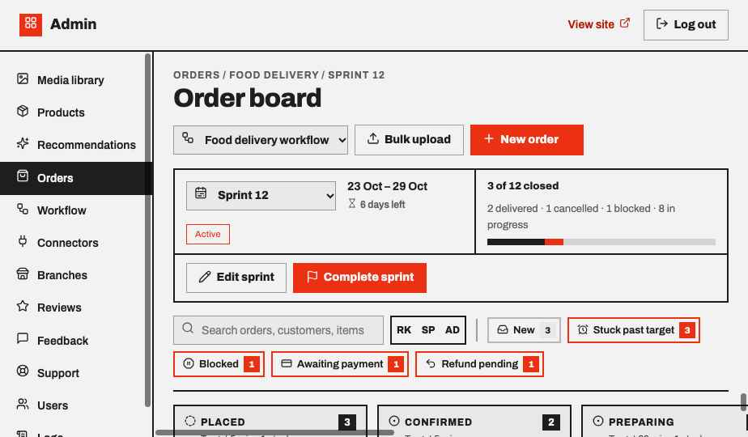

## 2. Sprint header
- Sprint picker (current and closed sprints), date range, days left, Active/Closed tag.
- Progress: "X of Y closed" with a bar split into closed (ink) and blocked (red), plus a breakdown by state.
- **Edit sprint** and **Complete sprint** actions.

## 3. Filters
Search by order ID, customer or item. Filter by staff member (initials) and by flag: New, Stuck past target, Blocked, Awaiting payment, Refund pending. Each flag shows a live count; flags needing attention are outlined in red. **Clear filters** resets everything.

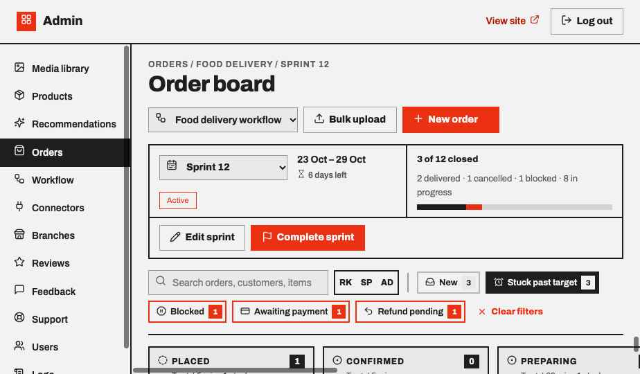

## 4. Order detail panel
Opens from any card. Shows status, time in status vs target, warnings (overdue, unassigned, unpaid, refund due), the next-stage action, secondary actions (Mark as blocked, Record payment, Send payment link, Refund, Print receipt, Cancel order), customer contact (Call, WhatsApp), staff assignment, stage history timeline and line items with total.

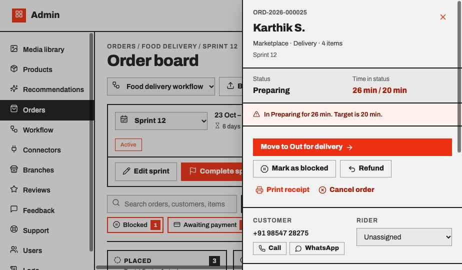

## 5. Blocked orders
Blocked orders keep their stage, pause the stage timer and show the reason and note. The primary action becomes **Resume in <stage>**.

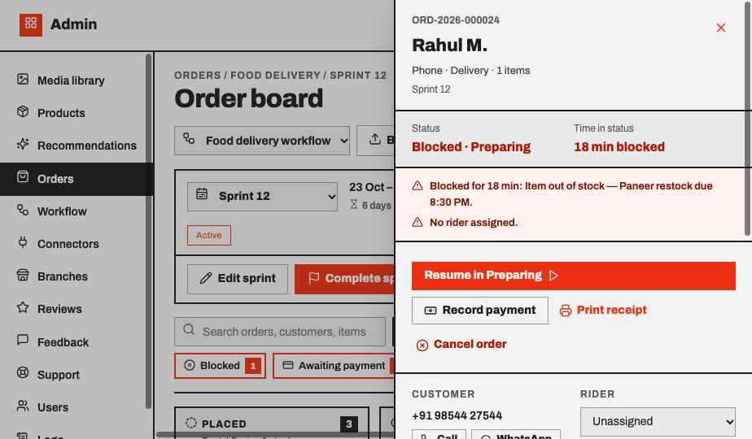

## 6. Blocking an order
Pick a reason (out of stock, customer unreachable, payment issue, staff unavailable, address issue, other) and add an optional note.

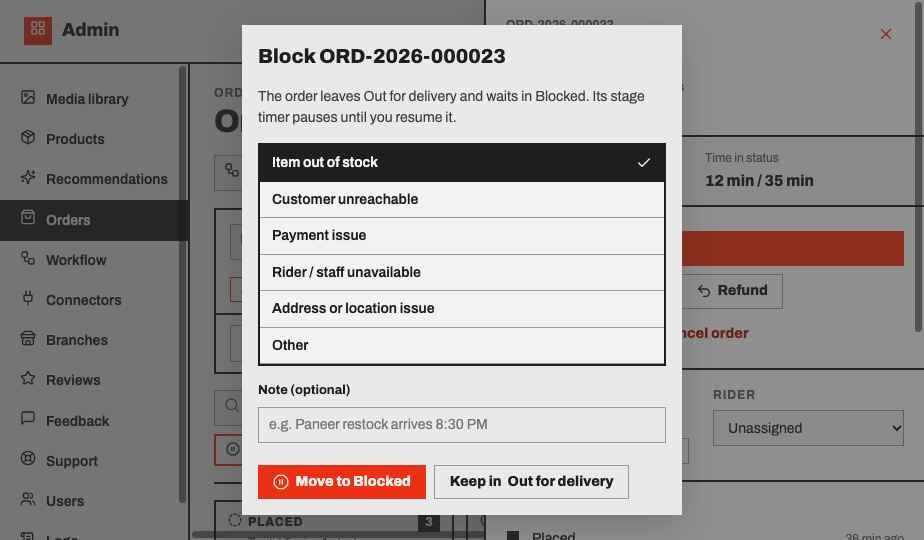

## 7. Payment collection guard
Moving an unpaid or cash-on-delivery order into the final stage prompts to record the payment first.

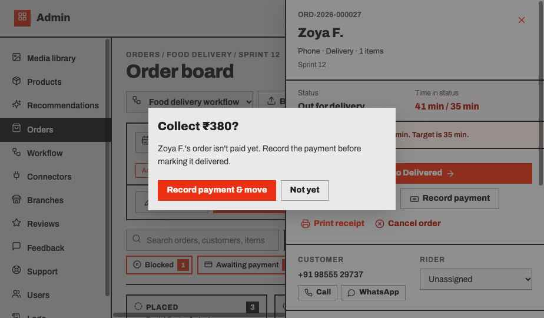

## 8. Completing a sprint
Summary of delivered, cancelled and not-closed orders. Set the next sprint's name and dates, and tick which open orders carry forward. Carried orders keep their stage, history and blocked status.

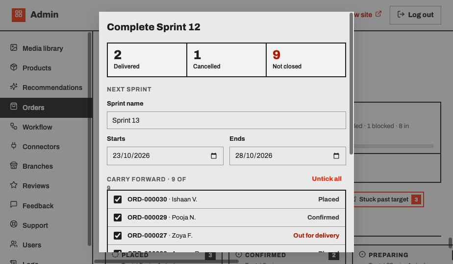

## 9. Editing a sprint
Rename the sprint and change its start and end dates.

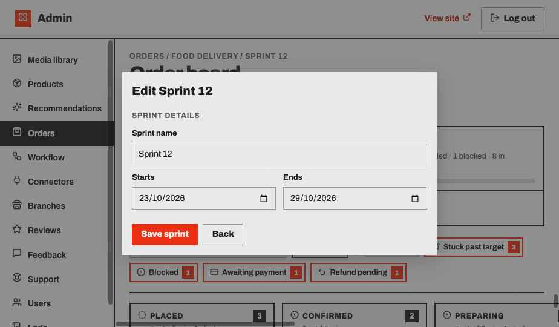

## 10. Drag and drop
Dragging a card highlights only the valid targets: the next stage, Blocked or Cancelled. Blocked cards can only return to their own stage or be cancelled. Invalid columns fade out. Dropping on Blocked opens the reason dialog; dropping on Cancelled asks for confirmation.

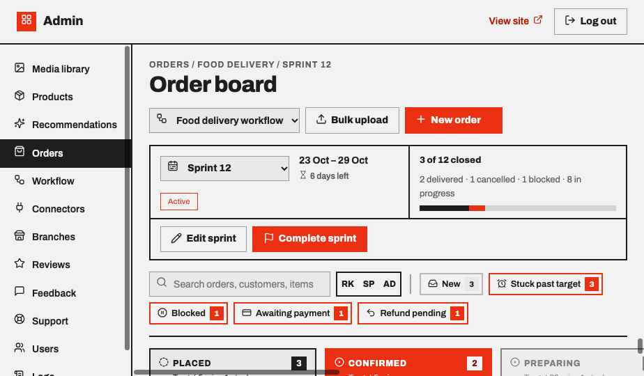

## 11. Closed sprints
Selecting a past sprint shows it read-only: no dragging, no stage actions.

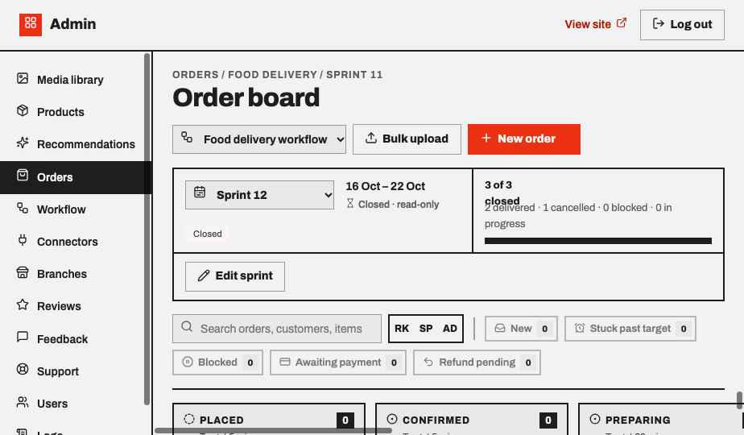

## 12. Multiple workflows
Each workflow has its own stages, time targets, staff role and sprints.
- **Food delivery** — Placed → Confirmed → Preparing → Out for delivery → Delivered (Rider)
- **Retail** — Placed → Confirmed → Packed → Shipped / Ready for pickup → Completed (Packer); the shipping stage depends on delivery vs pickup
- **Services** — Booked → Confirmed → Scheduled → In progress → Completed (Technician)

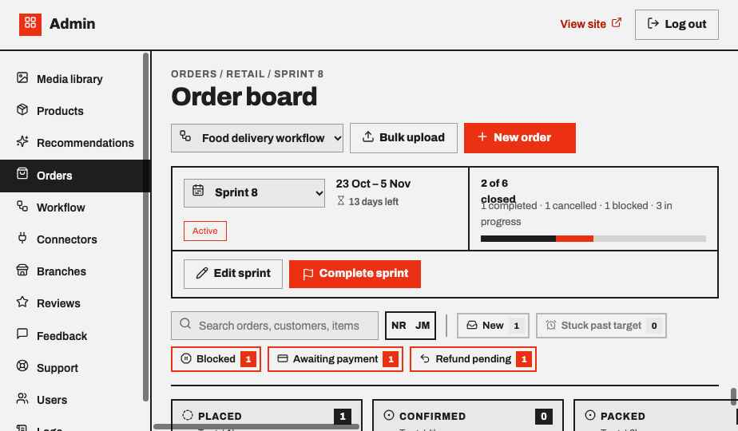
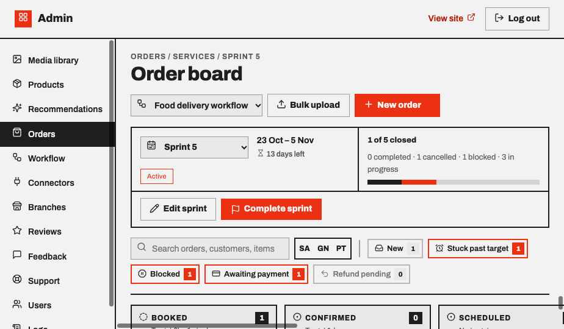

## UI notes for implementation (shadcn/ui + lucide-react)
- Header, sidebar nav → `Button` (ghost/outline), Lucide icons per nav item
- Workflow / sprint pickers → `Select` with leading icon
- Search → `Input` with leading `Search` icon
- Flag filters → toggle `Button` + count `Badge`
- Cards → `Card`; staff → `Avatar` with initials, `User`/`UserX` fallback
- Detail panel → `Sheet`; block, payment and sprint flows → `Dialog`
- Progress → `Progress` (two segments); carry-forward list → `Checkbox`
- Toasts → `Sonner`
